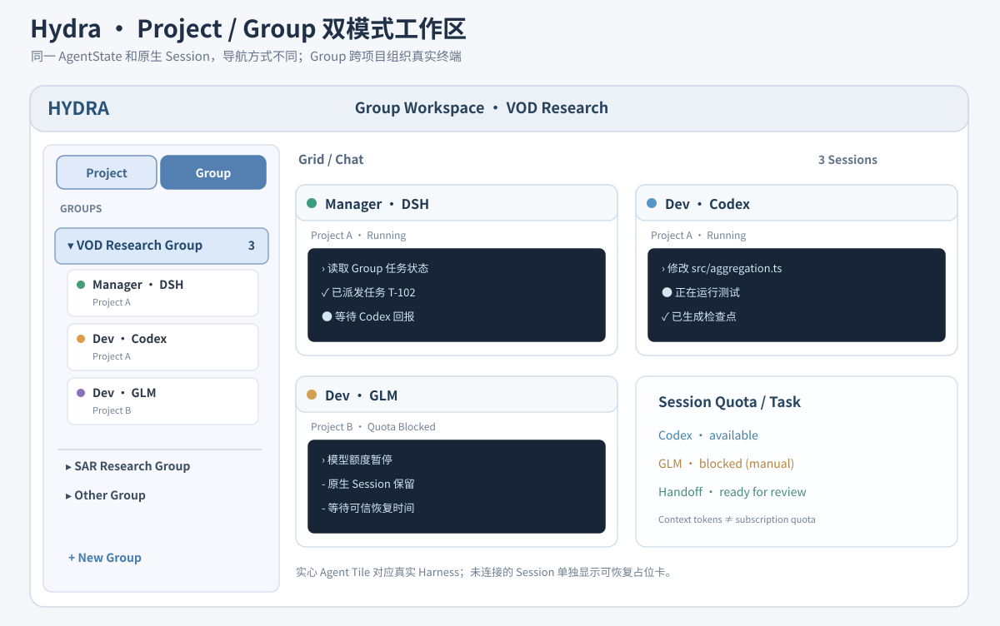
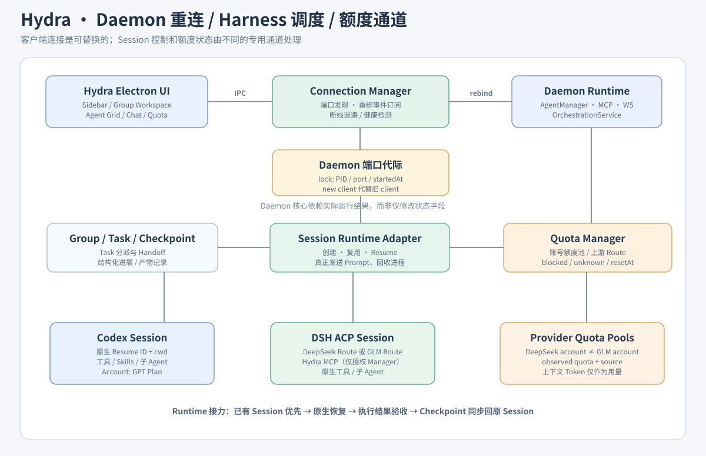

# Hydra 修复提案：Group 工作区、Daemon 自动恢复、真实 Session 调度与 DSH 额度通道

> **提案 / 尚未实施** · 2026-10-12 · 依据仓库 `main@3f4831f7` 的静态源码检查  
> **提交策略：**本 PR 仅新增设计文档和可编辑 SVG，不修改业务代码。先稳定 Daemon，再让 Group 成为真实工作区，之后打通运行时控制、DSH Manager 和额度。  
> **现象：**Windows 端出现 `agent:get-buffer → ECONNREFUSED 127.0.0.1:11876`。该现象只能确认旧端口不可达，**不能独立证明是 DSH 崩溃或 Daemon 因 DSH 退出**。需要诊断日志确认根因。

## 0. 目标效果

- 用户在左侧自由切换 **Project / Group 两种同等级导航方式**。
- Group 可以汇集一个或多个项目的多个真实 Harness Session；点击 Group 后，中央 **Grid / Chat** 直接显示全部关联 Agent 的**真实终端与状态**，不再只有管理表格。
- Group 负责组织，Session 负责原生工作上下文，Task 是可交接的工作目标；在切换导航时 **不创建、不停止、不改变 Session**。
- 用户可以任选 Codex、DSH、Claude 或 OpenCode 的 Session 充当 Group Manager；通过 Hydra MCP 真正调度真实的 Worker Harness，而非只更改编排数据库里的状态。
- Daemon 崩溃或端口变化后，客户端可重新发现端口、重新绑定所有事件订阅、恢复已有 Agent 视图；无响应时不反复向旧端口查询 `get-buffer`。
- DSH 通过 ACP 保留其原生模型路由、工具和子 Agent。**把上下文 Token 统计与账号/订阅额度分离**；GLM 的 5 小时配额是额度池的一个可能来源，不由 DSH 的 `ProviderId` 唯一决定。

### 设计图 A：Group 作为真实工作区



### 设计图 B：可恢复的 Daemon 与实际 Session / Quota 数据通道



## 1. 目前代码中的断点与证据

| 优先级 | 断点 | 当前代码 / 证据 | 后果 |
| --- | --- | --- | --- |
| P0 | Daemon 断线后主进程仍持有旧端口客户端 | `electron/daemon/DaemonClient.ts`：固定 `port`、WebSocket 只重连旧端口；`electron/daemon/lifecycle.ts` 的 `startHealthMonitor()` 重新调用 `ensureDaemon()` 但丢弃新的客户端；`electron/main.ts` 没有接入该 monitor | Daemon 即使重新在新端口启动，旧 IPC 仍向旧端口请求，导致重复 `ECONNREFUSED` |
| P0 | buffer 错误冒泡 | `electron/ipc/handlers.ts` 的 `IPC.AGENT_GET_BUFFER` 直接转发 `daemonClient.getBuffer()`；`src/hooks/useAgents.ts` 的恢复会批量读取缓冲区 | 用户看到连续的 Electron IPC handler error，界面无法给出准确的「Daemon 离线」状态 |
| P1 | GROUPS 仅是另一个面板入口 | `src/components/Sidebar/Sidebar.tsx`：点击组调用 `onOpenGroups`；项目 Agent 实际树由 `ProjectTree` 渲染 | Group 不是可展开且可操作的 Agent 树 |
| P1 | 主工作区强依赖 Project | `src/App.tsx` 依赖 `selectedProject / expandedTilesByProject`；`src/components/GridView/GridView.tsx` 根据 `projectDir` 筛选 | Group 跨项目无法作为 Grid 的真正作用域 |
| P2 | Session 暂停/恢复仅更改编排状态 | `electron/orchestration/SessionCoordinator.ts`：`suspend / resume` 调 `setLifecycle`；`resume` 仅置 `resume_pending` | 不能等同于真实 CLI/ACP 暂停与原生 Session Resume |
| P2 | Task/Handoff 主要是编排记录 | `TaskDispatcher.ts` 写 `assigneeSessionId`；`HandoffManager.ts` 记录并修改状态；真实 Agent `sendInput` 在 `AgentManager.ts` | Manager 无法仅靠 `hydra_task_assign` 确认 Worker 收到任务，更不能确认完成或源码已同步 |
| P3 | Manager Workspace 偏向 Claude | `electron/mcp/manager-workspace.ts` 生成 `CLAUDE.md`、`.mcp.json`，说明文档仍写“Claude agents” | DSH / Codex Manager 不一定看到正确的 MCP 指令和权限 |
| P3 | DSH ACP 创建/恢复不传 Hydra MCP | `electron/agents/dsh/acpClient.ts` 的 `newSession / resumeSession` 均传 `mcpServers: []` | DSH Manager 不能靠现有 ACP 会话创建路径获得 Hydra MCP 工具 |
| P3 | 用量和额度未贯通 | `src/components/UsageDashboard/UsageDashboard.tsx` 的 Provider 列表没有 DSH；`electron/agents/dsh/render.ts` 把 `usage_update` 显示为 context tokens；`QuotaManager` 独立存在 | Context 用量不是订阅剩余额度；缺少到 Session / Group 的可用性信号 |
| P0.5 | Quota 首次 observe 的状态写入存在潜在丢失 | `electron/quota/QuotaManager.ts` 在 `getQuotaPools()` 后调用 `ensurePool()`，接着却在旧数组 `pools.map` 上替换 | 新建的 QuotaPool 可能不包含最新 observation。应写回后重新读取，新增回归测试 |

> 上述均是**静态审阅发现**；尚未在提问者的 Windows 现场复现 Daemon 异常退出。实际崩溃原因需结合 `daemon.log`、进程退出码和启动日志定位。不要把现有编排状态误报为已经完成了实际调度闭环。

## 2. P0：先修复 Daemon 故障恢复和可靠错误展示

### 2.1 建议的基础组件

新增一个长期稳定的 **DaemonConnectionManager**（名字可调），不要让各 IPC handler、窗口监听器和 RemoteControl 直接捕获初始化时创建的 `DaemonClient`：

```ts
type DaemonConnectionState =
  | { status: "connecting" }
  | { status: "online"; generation: number; port: number; pid?: number }
  | { status: "reconnecting"; reason: string }
  | { status: "offline"; reason: string };

interface DaemonConnectionManager {
  current(): DaemonClient | null;
  requireClient(): Promise<DaemonClient>;
  subscribe(listener: (state: DaemonConnectionState) => void): () => void;
  reconnect(): Promise<void>;  // single-flight, bounded backoff
}
```

具体流程：

1. `ensureDaemon` 从 `daemon.lock` 读取当前端口，校验 `/health`，失败时处理陈旧锁并尝试启动。
2. 任意 HTTP 连接失败或 WebSocket 意外关闭后，Connection Manager 进入 `reconnecting`；将重复探测折叠为一次 single-flight。
3. **重新调用 `ensureDaemon` 并真正替换活跃 `DaemonClient`**，关闭旧客户端的 WS/重连定时器；客户端不再只尝试旧 TCP 端口。
4. 将 `agent:output`、`agent:status`、`orchestration:changed`、通知及其它事件订阅从旧客户端解绑，向新客户端重新注册，避免重复回调和内存泄漏。
5. 重新拉取当前 Agent List / Orchestration Snapshot / 必需 Buffer（有限并发与截断），恢复 UI；未验证连接前不报告“在线”。
6. 所有 IPC 通过可替换的 Connection Manager 动态取客户端，**不能继续使用关闭前的旧对象**。
7. 对短暂离线的 `AGENT_GET_BUFFER`：若有最后一次缓冲区则展示缓存，另显示“Daemon 重连中”；对写入/命令操作明确失败或用户确认重试，**不要静默吞掉 Prompt**。
8. UI 显示 `Online / Reconnecting / Offline` 与“查看 Daemon 日志”“手动重连”；防止每个 Agent Tile 同时高频重试。
9. 记录一次重连的 `oldPort/newPort/oldPid/newPid/reason/reconnectAttempt`（不得记录 token/凭据）；诊断包提供经脱敏的 `daemon.log` 相关尾部。

### 2.2 连接所有权和清理约束

- 不要在任意 `ECONNREFUSED` 时立即强杀旧 PID：先检查 PID/启动时间、lock 所有权，避免错误结束另一个 Hydra 窗口或其它用户的 Agent。
- 显式退出、退到后台、Daemon 崩溃是三种不同的行为；`APP_QUIT_BACKGROUND` 必须保留活跃 Agent，`APP_QUIT_FORCE` 明确停止它们。
- 重启后不能误称终端输出已完整恢复；丢失的 PTY 输出需记录窗口期，必要时从 Provider Session transcript 补充，而不是构造不存在的日志。
- 断线期间 UI 仍可查看最后状态，但所有依赖远端动作应提示 **暂不可执行**。
- 使用适合 Windows 的进程树退出/存活检测；由 Log 与连接事件确认根因，而不是假设 DSH 造成崩溃。

### 2.3 P0 验收

- **D-01** Daemon 被模拟异常结束（测试进程）：在限定的退避周期内变为 reconnecting，成功重启后自动显示同一个 Group/Agent 数据；不存在永久旧端口请求。
- **D-02** 强制令 Daemon 新端口与旧端口不同：主进程 HTTP + WS 全部切到新端口，事件订阅每种仅接收一次。
- **D-03** 渲染层 5 个 Agent Tile 并发取 Buffer 时断线：错误被聚合，不刷屏；Prompt 不被错误标记“发送成功”。
- **D-04** 正常应用后台退出再打开：如果 Daemon 和 Agent 正常运行，重连到**既有**实例，不产生双实例。
- **D-05** 启动前日志/lock 异常：给用户可操作的错误位置，不自动删除 Session 数据。

## 3. P1：Project / Group 双模式侧栏与真实 Agent 工作区

### 3.1 新的作用域（Scope）而非两套 Agent

```ts
type WorkspaceScope =
  | { kind: "project"; id: string }
  | { kind: "group"; id: string };

type SidebarOrganization = "project" | "group";

// Group 内可见 AgentState，由 nativeSessionId / agentId 连接；
// Group 中未启动的 HarnessSession 保留占位卡，展示可连接/可恢复状态。
```

设计原则：

- 左侧顶部增加 **Project | Group** 切换器，用户偏好持久化（迁移现有 `hydra:workspace-ui:v1` 时保留原项目选中状态）。
- Project 模式延续 `ProjectTree / AgentItem` 的行为与快捷键。
- Group 模式复用 `AgentItem` 的外观和运行状态：`Group → Manager/Planner/Worker Session → 对应真实 Agent`，支持展开、收起、选择、停止、切换模型和显示当前任务。
- 一个 Group 可以含多个项目的 Session：Agent 名称旁可显示其项目名；筛选/搜索仅作用于当前视图，不更改 Group 归属。
- 中央 Grid 使用 **Scope 解析后的 `AgentState[]`**，不再必须根据唯一 `selectedProject` 过滤；每张 Tile 仍绑定同一个真实 `AgentState.id`、终端 Buffer 和输入事件。
- 中央 Chat 模式选中 Group 中一个 Agent 时显示它的原生终端，保留切回 Grid 的 Group 作用域。
- 未启动的 Group Session 不假装成在线 Agent，应使用单独的 **占位卡**显示 `registered/suspended/resume_pending`、项目路径、原生 Session ID 状态和可执行的“启动/恢复”动作。
- `AgentGroupsPanel` 转为 Group 管理/配置/额度/接力详情抽屉，不再作为日常唯一入口。
- 与之前的 `RUNNING_PROJECT_ID` 视图保持兼容；对 Group 的广播仅发送给该 Group 实际成员，**不可因为跨项目就广播到所有项目**。
- 现有 Grid 的顺序、展开状态改用 `scope.kind + ':' + scope.id` 作为命名空间，避免同名 Project/Group 混淆。

### 3.2 建议触及的前端文件

| 现有文件 | 改造 |
| --- | --- |
| `src/App.tsx` | 新增 Scope 状态/持久化；Header 当前作用域与运行模式；将解析后 Agent 传给 Grid |
| `src/components/Sidebar/Sidebar.tsx` | 增加导航模式切换与 Group Tree，Group 点击不再仅打开 modal |
| `src/components/Sidebar/ProjectTree.tsx` / `AgentItem.tsx` | 保持 Project 模式，Group Tree 复用 AgentItem |
| `src/components/GridView/GridView.tsx` | 抽离“筛选 Agent”和“渲染 Tile”；支持显式 Agent 集合和 Scope；保留旧行为 |
| `src/hooks/useAgents.ts` / `useOrchestration.ts` | 通过 `HarnessSession.agentId` 建立索引；处理重新连接及遗留 Session |
| `src/hooks/useTileOrder.ts` | 按 Scope key 保存布局，跨模式不互相覆盖 |
| `src/components/AgentGroups/AgentGroupsPanel.tsx` | 仅保留管理侧栏/详情操作 |

### 3.3 P1 验收

- **G-01** 一个 Group 包含 Project-A Codex 和 Project-B DSH：左侧展开两成员，Grid 同屏展示可交互的真实终端。
- **G-02** Project→Group→Project 来回切换：无新进程、无新 Session；所有 Agent 原生 Session ID 与 cwd 不变。
- **G-03** 关闭再打开 Hydra：Scope、Group 展开状态、选中 Agent、Grid 顺序与窗口大小可恢复。
- **G-04** 未绑定 `agentId` 的注册 Session 可见但不可发送终端输入；被连接后变为真实 Agent Tile。
- **G-05** Group 广播只触达被授权的该组成员，不触及同项目的组外 Session。

## 4. P2：编排状态必须连接真实 Harness 生命周期

**当前目标从“记录 Session”提升为“调度真实 Session”。**

- 给 `OrchestrationService` / `SessionCoordinator` 注入可测试的 `AgentRuntimePort`（由现有 `AgentManager` 适配），避免编排层直接依赖 UI。
- 新建 Session：通过 Provider preflight → 启动真实 Agent → 获得 `AgentState.id`，收到原生 ID 后写入 `HarnessSession.nativeSessionId`；无法启动则显示失败，不能保留伪 Running 状态。
- 复用 Session：若对应 `agentId` 正在运行，直接发送 prompt；若未运行，则根据 Provider resume capability / cwd / write handle 条件恢复原生 Session 后再派发。
- `TaskDispatcher.assign` 先完成授权、quota、workspace 竞争、Session 所有权校验，再通过 runtime 投递，收到可观察的接收确认后变为 `assigned/active`；失败保存 `queued/blocked` 与可重试原因。
- 区分 `pauseDispatch`（停止接受新任务，不杀进程）和 `suspendRuntime`（在可中断点保存并停止可恢复进程）；界面两个动作的语义必须明确。
- 不同 Provider 的 Resume 能力有差异；DSH ACP 恢复要确认旧写句柄被释放且 `cwd` 一致，避免两个写者。
- Handoff 材料必须包含任务 ID、验收标准、检查点、Git commit/diff、未完成工作和风险；接力 Worker 要真实收到材料，完成后 `sync_back` 必须把验证结果发给原 Session。
- Group Manager 的“请求规划”应启动/复用独立 Planner Session，而不是假设 Manager 是永久在线的强模型。

**状态必须分层：**进程在线 ≠ Session 可输入 ≠ Task 已完成 ≠ 额度可用。所有 UI 都应保留真实判定证据。

### P2 验收

- **S-01** 同一 Worker 原生 Session 连续接收两任务，不能额外创建 Session。
- **S-02** 暂停派工后任务阻断但正在执行的 Prompt 不被错误杀掉；真 suspend 仅在 Provider 支持、快照完成后执行。
- **S-03** 额度 blocked 后不能向关联 QuotaPool 的 Session 派发新任务；可人工转交备用 Harness。
- **S-04** 原 Session Resume 后收到接力结果并继续开发；仅修改数据库字段不得判通过。
- **S-05** 双写同一目录会受阻，独立 Worktree 可并行，合并需 Review。

## 5. P3：DSH ACP Manager、模型路由与 QuotaPool 贯通

### 5.1 DSH Manager 通过 ACP 获得 Hydra MCP

现状：`acpClient.newSession/resumeSession` 强制 `mcpServers: []`；`manager-workspace.ts` 偏 Claude。

建议：

1. 在 Provider Adapter / CreateAgentPayload 引入 **Manager Capability**，在 Session 启动前确认 MCP Server 在线及 Manager 授权。
2. 为每种 Harness 生成正确的**原生**配置；对 DSH ACP，在其支持的格式和协商能力下向 `session/new` / `session/resume` 传入 Hydra MCP Server 定义，而不是空数组。**先用 DSH 当前 ACP 实现实际验证字段与传输类型，不盲目假定通用 JSON 对象即可工作。**
3. 对 Codex / Claude / OpenCode 采用各自受支持的 MCP 配置方式，不把 `CLAUDE.md` 当成通用指令入口。
4. Manager 工具最小权限：只能管理其 Group，跨 Group 操作、写入/合并、创建其它 Manager 等操作必须受保护；Hydra MCP 仅暴露给有权限的 Manager Session。
5. 在 UI 里显示“Manager MCP 已连接 / 未连接（原因）”，并做 `hydra_group_get_state` 工具调用烟测。
6. DSH 内部的子 Agent 由 DSH 自身管理，Hydra 不强行枚举所有内部子 Agent。

### 5.2 额度池跟踪的真实作用域

**Harness ≠ Model Route ≠ 计费账号 ≠ QuotaPool。** 建议新增路由映射：

```ts
interface EffectiveModelRoute {
  harnessProvider: "dsh" | "codex" | "claude" | "opencode";
  upstreamProvider: string;   // e.g. deepseek, z-ai
  modelId: string;
  accountAlias: string;       // 本地用户自定义别名，不存 token
  quotaPoolId: string | null;
}

interface QuotaObservation {
  availability: "available" | "degraded" | "blocked" | "unknown";
  resetAt: string | null;
  observedAt: string;
  source: "official" | "cli_signal" | "manual" | "estimated" | "unknown";
  confidence: "high" | "medium" | "low";
}
```

- 同一个 DSH Session 改选 GLM 后，需要重新解析额度池归属；不能因为 Harness 仍叫 `dsh` 就共享 DeepSeek 额度。
- 同一订阅账号下多个 Session 共用额度池；不得为每个 Session 虚构额度。
- ACP `usage_update` 的 `used / size` 是上下文 Token 占用信息，不能推导剩余账号额度百分比或“5 小时后一定恢复”。
- 把 Provider 的真正额度错误信号归类写入 QuotaManager，记录来源、置信度与观测时间；对普通 `429` / 连接超时等保持 `unknown/degraded`，不伪造 `resetAt`。
- 没有稳定机器可读接口时，允许手动标记 blocked/available，并显示该状态是**人工模拟**还是官方上游观测。
- 修改 `electron/quota/QuotaManager.ts` 的首次 observe 写回逻辑：`ensurePool` 之后重新读取持久化数组，再替换匹配项；添加首次观察、重复观察和跨路由用量不串池测试。
- 统一呈现“Session context tokens / 上游可用额度 / QuotaPool / 观测来源”四项；`UsageDashboard` 与 Group 的 QuotaPanel 共享后台快照，不靠终端 ANSI 文本解析。

### 5.3 DSH 终端体验（在 MCP 与额度后）

- ACP `session/update` 的 `plan/plan_update` 等消息应形成结构化进展列表，终端仍保留简洁文本，不将控制消息混入 Agent 答案。
- `/status` 显示 Session ID、实际 Route、Manager MCP 健康及额度来源；不能把 Context Token 显示为订阅余额。
- Windows 下验证 PTY bridge、`dsh --profile acp` 启动失败提示、权限弹窗、`Ctrl-C`、重开 Session、孤儿进程/写句柄回收。
- 若 DSH 没有稳定 TUI，**继续使用 ACP Bridge**，而不是为了 Group 模式重新实现全套 DSH CLI。

### P3 验收

- **M-01** DSH Manager 经 ACP 能调用 `hydra_group_get_state` 与 `hydra_task_assign`，并证明 Worker 收到真实 Prompt。
- **Q-01** DSH DeepSeek Route 和 GLM Route 映射到不同 Pool，任一 Pool blocked 不影响另一个。
- **Q-02** `usage_update` 只影响上下文显示，**不**修改额度状态。
- **Q-03** 首次 Quota observation 可持久化，并在重启后正确读取。
- **Q-04** 没有可信 `resetAt` 的额度池只显示 unknown，不给出虚构倒计时。
- **Q-05** DSH Manager 与普通 DSH Worker 具有不同的 Hydra MCP 权限。

## 6. 推荐实施顺序与 PR 拆分

| PR | 顺序 | 交付 | 允许进入下一阶段的 Gate |
| --- | --- | --- | --- |
| A | **P0** | DaemonConnectionManager + UI 重连提示 + 日志定位 + 旧端口重发现 | D-01~05；Node/Electron typecheck、Windows 真实退出/恢复烟测 |
| B | **P0.5** | Quota observe 首次写入修复 + 回归测试 | 新池首次观察后数据不会丢失 |
| C | **P1** | Project/Group 作用域、GroupTree、复用真实 Agent Tile/Grid/Chat | G-01~05，Project 模式无回归 |
| D | **P2** | 运行时与编排层连接、Task 真正送达、Session 真正 Resume、Handoff 回传 | S-01~05 |
| E | **P3** | DSH ACP Manager MCP、上游模型路由/账号额度映射、Quota Adapter 与 GUI 状态 | M-01/Q-01~05 |
| F | 后续 | DSH 终端交互、计划列表、复杂 Planner | Windows 实机烟测 + 不影响已有 Provider |

**不要在同一 PR 中同时重构 Daemon、Grid、ACP 与 Quota**；每一步都保留 rollback 点。现有 `npm test` 与 `npm run typecheck` 为基础门禁，但不能替代真实进程和 Session 接力的 E2E。

## 7. 故障复现与诊断记录模板

已知症状：

```text
Error occurred in handler for 'agent:get-buffer':
Daemon connection error: connect ECONNREFUSED 127.0.0.1:11876
```

建议每次现场复现收集：

```yaml
time_local: "YYYY-MM-DD HH:mm:ss"
platform: "Windows 11 / Electron version / Hydra commit"
action_before_failure: "e.g. open DSH session, switch group, restart app"
daemon_lock: { pid: null, port: null, startedAt: null }
port_listening: "true / false / unknown"
daemon_log_tail: "redacted excerpts"
main_process_log_tail: "redacted excerpts"
dsh_acp_processes: "PID / parent PID / command name only"
native_session_ids: "redacted identifiers"
workspace_git_state: "clean / dirty"
outcome: "reconnected / needs manual action / lost terminal output"
```

本地 PowerShell 核查（**只读**，避免先删除用户 Session）：

```powershell
Get-NetTCPConnection -LocalPort 11876 -ErrorAction SilentlyContinue
Get-CimInstance Win32_Process |
  Where-Object { $_.CommandLine -match 'hydra|daemon\.js|dsh' } |
  Select-Object ProcessId, ParentProcessId, CommandLine
Get-ChildItem "$env:APPDATA" -Recurse -File -Include daemon.log,daemon.lock -ErrorAction SilentlyContinue |
  Where-Object { $_.FullName -match 'hydra' } |
  Select-Object FullName, LastWriteTime
```

收集日志时请对凭据、私有路径和 Prompt 等敏感文本进行脱敏；**不要上传完整 Session transcript 或 API key**。

## 8. 最终产品验收

1. 用户在左侧切换 `Project ↔ Group`，既能看到原先按项目的 Agent，也能在跨项目 Group 中操作同一真实 Agent；无额外 Session 启动。
2. 正在运行 DSH Manager 的 Group 能通过 Hydra MCP 将实际代码任务交给 Codex Worker；进度和终端事件可追踪。
3. GPT/GLM 相应额度池人工 blocked 后，调度器停止向该池派发新任务，记录 Checkpoint；其他 Pool 可以继续。
4. DSH 接力后，原 Codex Session 按真实 Provider Resume 恢复，收到交接材料并可继续工作；代码测试给出可验证证据。
5. Daemon 断线/新端口启动后，所有 Agent Tile 从旧连接迁移到新连接，不再持续弹 `ECONNREFUSED`，也不丢 Group/Session 关联。
6. 任一项失败时 UI 提供准确状态和可审计失败原因，而不是仅把进度标签设置为成功。

**非目标：**本提案不要求替换原生 Harness 的子 Agent 系统，也不声称 V1 已有自动额度检测或跨 Provider 原生 Session 格式迁移能力。
